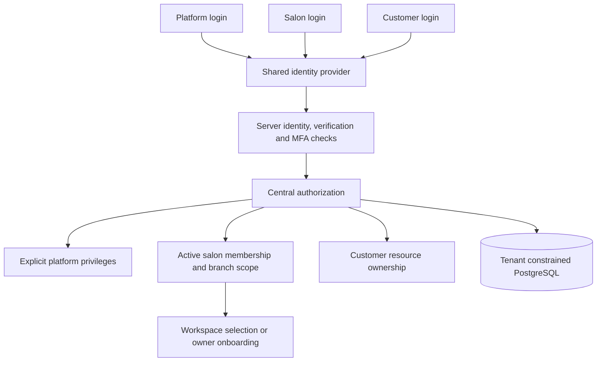
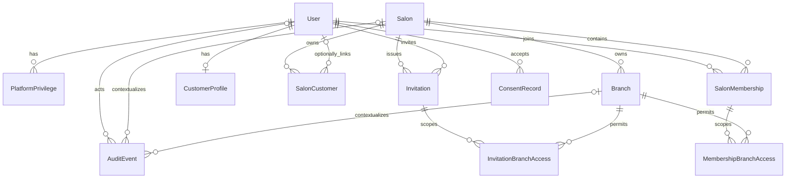

# Saloonsync authentication: proposed implementation

Status: Supabase selected by the user; implementation available. See verification-report.md for verified behavior and remaining deployment configuration.

## Repository inspection

The workspace was empty on inspection. There is no Git repository, AGENTS.md,
framework, dependency manifest, existing provider, database, UI, logo, legal
documents, deployment configuration or test suite to preserve.

## Architecture

Use Next.js App Router, strict TypeScript, React, Tailwind, Zod, PostgreSQL
and Prisma. Selected identity provider: Supabase Auth.
Use provider-managed credentials, verification, recovery, sessions and MFA.
Pin compatible package versions and commit a lockfile after selection.

Privileged modules use server-only boundaries. Every action, route handler and
repository query checks current authorization. Never trust a role, tenant,
branch or customer identifier from the browser. Platform grants do not bypass
salon or customer checks. Read current membership and privilege records on each
protected operation so revocation takes effect without waiting for JWT refresh.
No public platform signup or support impersonation.

## Permission matrix

All entries require active identity, verified email and relevant resource scope.
Selected branch scope restricts every operational permission.

| Permission | Owner | Admin | Manager | Staff | Customer | Platform |
|---|---|---|---|---|---|---|
| Ownership transfer | Yes | No | No | No | No | No |
| Salon settings | Yes | Yes | No | No | No | No |
| Invite admin/manager/staff | Yes | Manager/staff only | No | No | No | No |
| Assign owner | Controlled transfer | No | No | No | No | No |
| Manage branches | Yes | Yes | No | No | No | No |
| Branch appointments | Yes | Yes | Yes | Assigned work only | Own bookings only | No |
| Salon customer records | Yes | Yes | Scoped operations | Minimum assigned work | No | No |
| Own customer profile | Own | Own | Own | Own | Own | Own |
| Platform administration | Separate grant | Separate grant | Separate grant | Separate grant | Separate grant | Named privilege only |

Use explicit permissions such as salon.settings.write, membership.invite,
branch.manage, appointment.manage, appointment.assigned.read and platform.manage.
Unknown permissions deny access. Invitees cannot grant permissions they do not
hold; delegated administrators cannot grant owner or admin roles.

## Logical schema

All entity IDs are UUID primary keys unless a composite key is specified.
All timestamps are timestamptz. Business tables include created_at and updated_at.

| Table | Fields and constraints beyond primary key |
|---|---|
| User | provider identity UUID unique; display_name; disabled_at nullable; no credential storage |
| Salon | name; slug unique; status active/suspended/closed |
| Branch | salon_id FK; name; status; unique(id,salon_id) |
| SalonMembership | salon_id FK; user_id FK; role owner/admin/manager/staff; branch_scope all/selected; status invited/active/suspended/revoked; unique(salon_id,user_id); unique(id,salon_id) |
| MembershipBranchAccess | primary key(membership_id,branch_id); salon_id; composite FKs (membership_id,salon_id) and (branch_id,salon_id) |
| PlatformPrivilege | user_id FK; privilege; status active/revoked; granted_by nullable FK User for controlled bootstrap; granted_at; revoked_at; unique(user_id,privilege) |
| CustomerProfile | user_id PK/FK; customer-specific profile fields |
| SalonCustomer | salon_id FK; user_id nullable FK; salon-owned contact information and notes; unique(id,salon_id) |
| Invitation | salon_id FK; normalized intended_email; role; branch_scope; token_hash unique; invited_by FK; expires_at; accepted_at/revoked_at/accepted_by nullable; unique(id,salon_id) |
| InvitationBranchAccess | primary key(invitation_id,branch_id); salon_id; composite FKs (invitation_id,salon_id) and (branch_id,salon_id) |
| ConsentRecord | user_id FK; document_type; document_version; purpose; accepted_at; withdrawn_at nullable |
| AuditEvent | actor_user_id nullable FK; salon_id nullable FK; branch_id nullable; action; target_type; target_id; outcome; occurred_at; bounded sanitized metadata; composite branch tenant FK |

Invitation accepted_by references User. Audit branch_id requires salon_id.
Appointments, invoices and inventory must carry salon_id and composite branch
references; bookings also require an authenticated customer ownership check.
Never merge or share salon customer notes through a global profile.

Index memberships(user_id,status), memberships(salon_id,status,role),
branches(salon_id,status), invitations(salon_id,intended_email,expires_at),
privileges(user_id,status), salon_customers(salon_id,user_id),
audit_events(salon_id,occurred_at), consent_records(user_id,document_type).
Index referencing foreign keys where not covered by a leading index column.
Use CHECK constraints for lifecycle values, consistent acceptance/revocation
fields and positive invitation lifetime. Use restrictive deletes for ownership,
membership and audit history; deactivate entities instead of cascading history.

## Transactions and lifecycle

Membership: invited -> active -> suspended -> active; active/suspended -> revoked.
Reactivation requires an authorized action. Selected scope requires at least one
branch. Owners require all-branch scope. Enforce these invariants in database
constraint triggers as well as service validation.

Invitation: pending -> accepted, revoked, or expired. Expiry is evaluated against
database time. Acceptance requires the provider's verified email to match the
normalized recipient. Hash cryptographically random tokens with SHA-256; store
and log no raw tokens. In a transaction lock salon and invitation, verify status,
expiry and current inviter authority, create/reactivate membership with exact
scope, copy branch grants, mark accepted, and insert an audit event. An invitation
must never overwrite an existing active membership's role. Concurrent acceptance
has exactly one winner. Revocation follows the same lock order.

Serialize all owner-affecting changes by locking the salon row. A database trigger
must reject removal, suspension or demotion of the last active owner. Transfer
adds the new verified active owner and then demotes the former owner in one
transaction. Profile disablement also checks affected salons under ordered locks.

Onboarding transaction creates salon, first branch, owner membership, scope and
audit record. Use an idempotency key to prevent duplicate salons on retries.
Customer signup creates no salon and no membership. Provider identity creation
and database writes cannot share a transaction: make identity synchronization
idempotent and recover safely on callback retries.

## Routes and user experience

Implement /platform/login, /platform, /platform/access-denied;
/salon/login, /salon/register, /salon/select-workspace, /salon/onboarding,
/salon/invitations/accept, /salon, /salon/access-denied;
/customer/login, /customer/register, /customer;
and /auth/forgot-password, /auth/reset-password, /auth/verify-email, /auth/callback.
Provide provider-backed logout with a POST operation.

Headings: “Manage the platform.”, “Run your salon.”, “Plan your next visit.”
Use ivory backgrounds, plum controls, serif headings, sans-serif form text,
desktop split layout and form-first mobile layout. No fabricated logo or claims.
Shared components: AuthLayout, AuthBrandPanel, EmailField, PasswordField,
ConsentField, SubmitButton, AuthStatusMessage, WorkspaceSelector,
AccessDeniedState and VerificationNotice. Include persistent labels, autocomplete,
linked errors, live status announcements, visible focus, reduced motion and
duplicate-submit protection. Authentication success requires provider confirmation.

After salon authentication: one active membership opens its workspace; several
show selection; none offers onboarding or invitation guidance. Suspended/revoked
workspaces are denied. Preserve invitation context through verification using
server-held state; never use raw invitation tokens in telemetry. Allow only known
internal destinations; reject absolute URLs, protocol-relative paths, encoded
bypasses and backslash variants. Never accept arbitrary callback destinations.

Registration requires finalized applicable terms and versioned acceptance plus a
privacy notice. Those documents are currently missing: do not fabricate legal
text or enable a purported finalized agreement. No marketing checkbox without a
real subscription workflow. Show actual configured provider password guidance.

## Migration and implementation sequence

1. Obtain identity-provider selection; confirm actual repository location.
2. Scaffold selected stack and pin dependencies; configure isolated development.
3. Add additive Prisma migrations for identities, salons, branches, memberships,
   customer profiles, invitations, consent and audit. Include custom SQL composite
   FKs and invariant triggers. Review generated SQL before applying locally.
4. Implement server identity, privilege, membership, branch and permission helpers;
   scoped repositories; invitation and ownership transactions.
5. Implement shared forms, three login experiences, registration, provider callback,
   verification, reset, logout and platform MFA checks.
6. Add workspace selection and onboarding; integrate invitation acceptance.
7. Add mocked unit tests, isolated database integration tests and browser tests.
8. Run type checking, tests and production build; render desktop/mobile pages.
9. Document rollout and obtain missing production configuration and legal assets.

Use expand/backfill/validate migrations for future populated tables; do not reset
databases or drop existing data. Run migrations once in a controlled deployment
job, not during every application instance startup. Restore-test backups before
production rollout. This document is not an executable migration.

## Environment, deployment and verification plan

Use separate provider projects and databases for development, preview and
production; Vercel deployment with a supported Node.js LTS. Proposed environment:
NEXT_PUBLIC_SUPABASE_URL, NEXT_PUBLIC_SUPABASE_PUBLISHABLE_KEY, DATABASE_URL,
DIRECT_URL and APP_ORIGIN. Database credentials stay server-only. Configure exact
callback URLs, SMTP delivery, email templates, rate limits and platform MFA.
Avoid a service-role key in normal request handlers. Private application schemas
must not be exposed to the provider Data API; use least-privilege database roles.
Provider SSR cookie refresh and CSRF/origin checks follow verified current docs.

Vitest: permission matrix, deny defaults, input validation, password mismatch,
consent, redirect attacks and sanitized errors. Mock provider and email calls.
Isolated PostgreSQL integration: composite tenant integrity, direct unauthorized
requests, current revocations, branch scope, customer ownership, invitation
expiry/reuse/revocation/concurrency and concurrent last-owner changes.
Playwright: all portals, verification/recovery/MFA, session expiry/logout,
workspace counts and denied states, keyboard semantics and mobile/desktop layout.
No real accounts, email sends or production data modifications during testing.

## Original inspection checkpoint (superseded by verification-report.md)

Implemented: repository inspection and this proposed architecture/schema plan.
Verified: workspace is empty and no existing project instructions were found.
Not implemented or verified: application, migrations, authentication, authorization,
emails, browser behavior, type checks, tests and build. No runnable project exists.
Blockers: provider selection; production provider/database configuration; supplied
logo; finalized legal documents. Only provider selection blocks starting the
provider-dependent implementation; missing brand/legal assets can be kept as
explicit release blockers while development continues.
